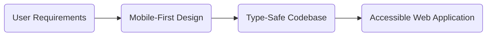

## Durable architecture and client ownership

Software investments should hold their value over multiple years without requiring frequent rewrites:

- **Modern standard stack.** We build with Next.js, React, TypeScript, and standard web APIs, keeping dependencies minimal and well-maintained.
- **Direct client ownership.** You receive full access to the source code repository, documentation, and deployment infrastructure. There is no vendor lock-in or proprietary runtime.
- **Auditable security.** Systems use standard authentication patterns, strict role separation, and clean audit logs.

## Working together

If you are planning a new application or modernizing an existing system, contact our team to discuss your project requirements, timeline, and architectural approach.
