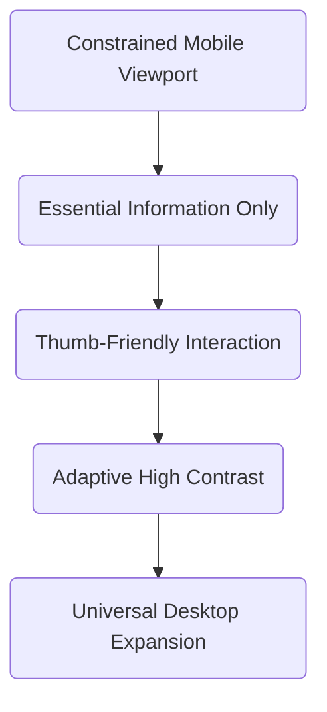

# Mobile-First Accessibility: Why Design Begins on Small Screens

Most modern web traffic originates from handheld devices, yet web applications are still frequently architected on 32-inch monitors before being squeezed onto phones as an afterthought.

At Invent Peace, every layout and workflow begins on the most constrained surface. When an interface succeeds on a 375px viewport under direct sunlight, it excels effortlessly everywhere else.

## The Reality of Field-Level Operations

Frontline workers, healthcare professionals, and logistics managers don't interact with web software from quiet desks. They work in variable environments with fluctuating connectivity and one-handed operation.

### Core Design Rules for Mobile Reliability

1. **Generous Touch Targets**: Minimum 44×44px interactive surfaces with intentional spacing to prevent misclicks.
2. **Immediate Hierarchy**: No nested menus for primary daily tasks. Critical actions sit in the natural thumb zone.
3. **Graceful Degraded Performance**: Interfaces render smoothly even on low-end hardware or intermittent cell networks.

> 💡 **Principle**: Complexity that cannot survive on a smartphone screen is usually unnecessary complexity on a desktop monitor.

## Measurable Results

By stripping away superfluous desktop adornments, our clients consistently observe faster task completion rates and fewer data entry errors across all departments.
