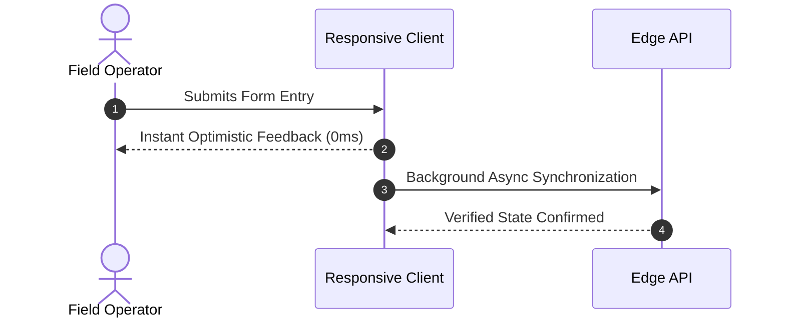

# Zero-Fatigue Engineering: Eliminating Cognitive Overload in Web Software

Modern enterprise platforms often burden operators with visual clutter, infinite alert banners, and sluggish transitions. When tools require conscious mental effort to navigate, fatigue sets in—leading directly to operational errors and delayed decision-making.

## Intentional Architecture

We believe software should feel invisible. Users should accomplish their goals with the lowest possible cognitive friction.

### The Anatomy of Low-Friction Interfaces

- **Sub-100ms Interactions**: Instant local feedback removes the uncertainty of whether an action succeeded.
- **Predictable Information Density**: High-signal data layouts that prioritize scanning over endless scrolling.
- **Calm Visual Palettes**: Restrained neutral tones with functional accents designed for sustained 8-hour work sessions.

## Built for Long-Term Resilience

By avoiding bloated third-party dependencies and focusing on lean, standards-compliant web technologies, we ensure that every application remains fast, secure, and easily maintainable for years to come.
