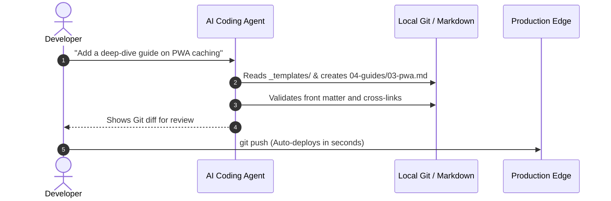

Modern coding agents like Antigravity, Cursor, GitHub Copilot, and Claude are native file system operators. They analyze source code, write documentation, refactor directories, and verify changes through Git diffs.

Traditional CMS platforms force AI assistants into convoluted REST API calls, fragile database migrations, or OAuth authentication gymnastics. **The Static Web** was engineered from day one to be the native interface for autonomous agents.

### Direct File Read & Write
Agents do not need access tokens or headless dashboard passwords. They simply read `content/_templates/00-article-template.md`, compose the markdown with YAML front matter, and save the file directly to disk.

### Deterministic Review with Git Diffs
Every word, image reference, and front-matter tag authored by AI appears in your pull request or local git diff. You maintain full oversight and version control before publishing to production.

### Zero-Friction Content Migration
When switching teams, frameworks, or hosting providers, your content repository travels with you unchanged. No CSV exports, no orphaned database rows, and zero vendor lock-in.

