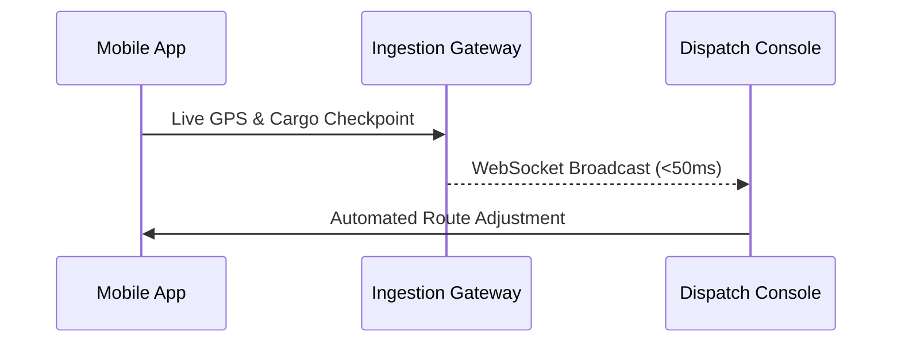

# Real-Time Fleet & Logistics Dispatch Engine

Coordinating freight logistics across international corridors requires split-second operational decisions. Legacy ERP software relied on static batch updates, causing dispatchers to work with stale information.

Invent Peace engineered an event-driven dispatch platform providing real-time location telemetry, status change notifications, and route optimization.

## The Problem

Dispatchers were forced to maintain spreadsheets alongside disparate GPS trackers, phone calls, and terminal logs. Communication delays led to empty return trips (deadheading) and costly customs penalties.

## Architectural Highlights

- **WebSocket Live Feeds**: Sub-50ms latency updates across thousands of fleet vehicles simultaneously.
- **High-Density Keyboard-First Grid**: Designed for high-volume dispatchers who prefer hotkeys and instant search over slow mouse clicks.
- **Automated Exception Highlighting**: AI-assisted anomaly detection flags potential border bottlenecks before drivers arrive.

## Impact

- **22% Reduction in Empty Mileage**: Intelligent route re-assignments lowered deadhead miles substantially.
- **Instant Dispatch Velocity**: Average load assignment times went from 25 minutes to under 3 minutes.
