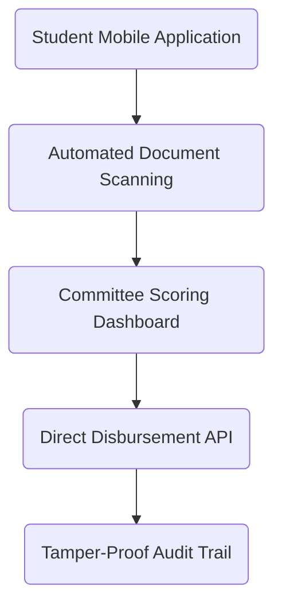

# Institutional Micro-Grant Distribution Portal

Disbursing micro-grants to students and community organizations often suffers from cumbersome bureaucratic friction, complicated eligibility forms, and sluggish manual approvals.

Invent Peace built an accessible, transparent distribution system that enables quick application submissions, automated identity verification, and multi-signature fund release.

## Transparent & Accountable Architecture

### Key Deliverables

- **Mobile Document Ingestion**: Allows applicants to snap pictures of transcripts and IDs with auto-cropping and OCR verification.
- **Role-Based Committee Review**: Streamlined consensus workflow allowing evaluation committees to score grant batches in minutes.
- **Audit Logging**: Immutable event ledger ensuring compliance for public institutions and charitable foundations.

## Results

- **Application cycle decreased from 30 days to 72 hours**.
- **99.4% first-time submission completion rate** across first-generation college applicants.
