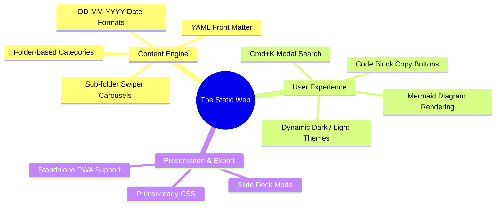

The Static Web combines the lightning performance of static assets with the dynamic richness of modern interactive web applications. You get the best of both worlds: zero server complexity paired with a responsive, magazine-grade reading experience.

### 1. Sub-Folder Swiper Carousels
Turn deep topic breakdowns into elegant, swipeable card carousels simply by creating sub-folders with decimal numbering like `0.3.1-feature.md`. The engine parses these into interactive touch-friendly slides without writing custom React code.

### 2. Instant Pre-Indexed Search (`Cmd+K`)
Our build process pre-indexes all articles and categories into an optimized client-side search tree. Visitors can hit `Cmd+K` (or `Ctrl+K` on Windows/Linux) and search full articles in milliseconds with keyword highlighting.

### 3. Native Mermaid & Syntax Highlighting
Write architectural workflows, state diagrams, and entity relations directly in markdown code fences using `mermaid`. The compiler transforms them into clean, responsive SVG diagrams on the fly.

