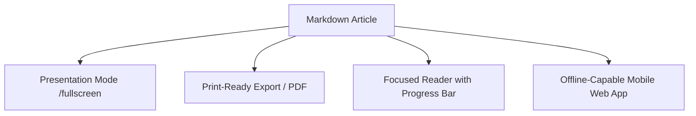

Documentation shouldn't just be text on a page. The Static Web equips teams with high-utility reading, presenting, and sharing tools built right into every article.

### Presentation Slide Deck Mode
Click the presentation button or navigate to any article's presentation route to instantly transform your markdown sections into full-screen, keyboard-navigable presentation slides. Perfect for engineering syncs, design reviews, and conference walkthroughs.

### Progressive Web App (PWA) Out-of-the-Box
The Static Web includes a configured service worker, manifest, and responsive icon assets. Users on iOS and Android can install your portal directly to their home screen for fast, app-like loading.

### Responsive Theme Switcher & Typography
Designed with accessibility at its core, the UI supports light, dark, and system themes with tuned contrast ratios, fluid typography, and clean code block copy buttons.

