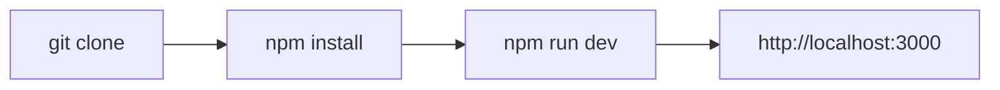

Getting started with The Static Web takes only a terminal and Node.js. Follow these three steps to get your environment up and running.

### Step 1: Clone the Repository
Clone the repository from GitHub to your local machine:

```bash
git clone https://github.com/powerplayguy84/thestaticweb.git my-portal
cd my-portal
```

### Step 2: Install Dependencies
Install packages using npm:

```bash
npm install
```

### Step 3: Start the Development Server
Launch the Next.js local server:

```bash
npm run dev
```

Open your browser to `http://localhost:3000`. You will see the complete portal running with hot-reloading enabled. Any markdown file you create or edit will update live in your browser.



