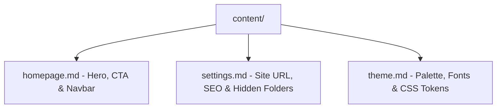

All site settings in The Static Web are stored in human-readable Markdown configuration files inside the `content/` folder.



### 1. Configure Site Metadata (`settings.md`)
Open `content/settings.md` to define your domain, SEO description, and hidden folders:

```yaml
---
siteUrl: "https://yourdomain.com"
siteTitle: "Your Portal Name"
siteDescription: "Your portal SEO description"
author: "Your Team"
hiddenCategories:
  - "_templates"
adminPassword: "admin123"
---
```

### 2. Customize the Homepage Hero (`homepage.md`)
Adjust hero headlines, call-to-action buttons, and header brand presentation:

```yaml
---
title: "Your Knowledge Portal"
subtitle: "High impact documentation engineered for modern teams."
description: "Everything you need to build, deploy, and scale."
navbar:
  title: "Brand Name"
  logo: "/logo.png"
  logoStyle: "fullwidth"
---
```

### 3. Adjust Theme Colors (`theme.md`)
Visit `/theme` in your browser to interactively customize your color tokens, or modify `content/theme.md` directly to adjust primary, background, and accent tones for light and dark modes.

