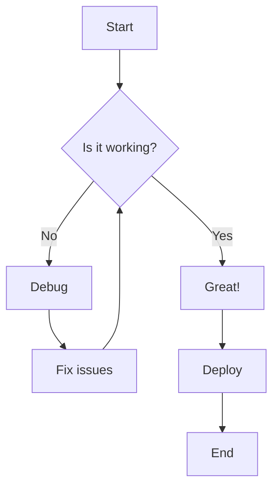
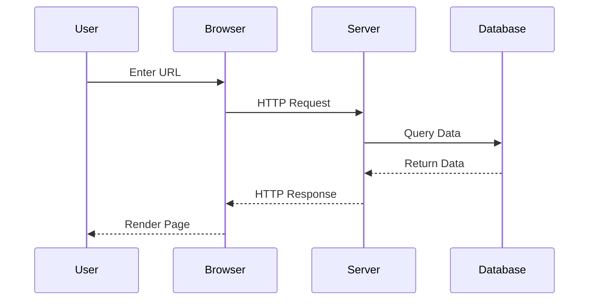
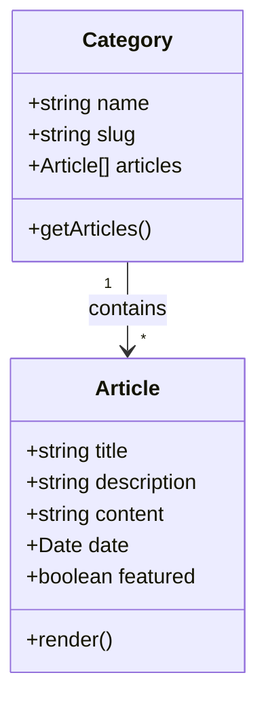
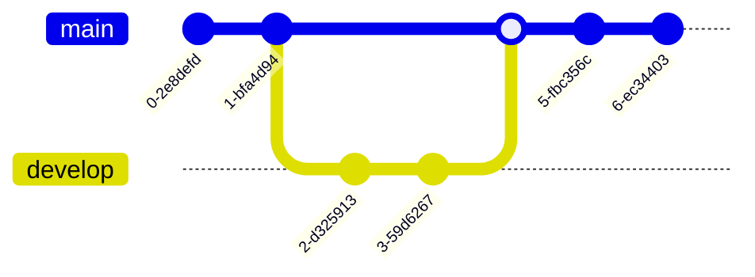
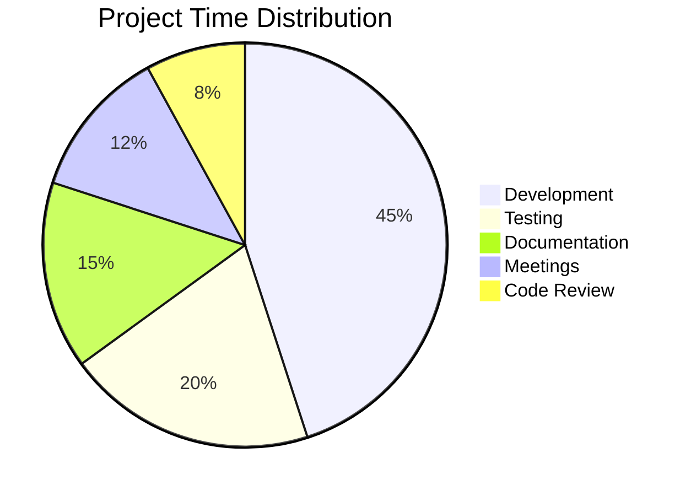
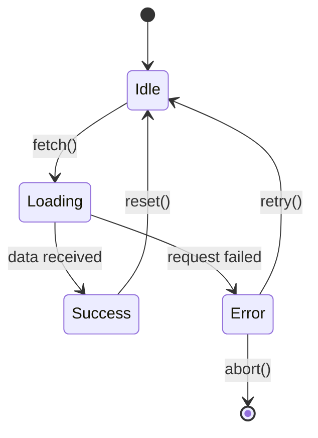
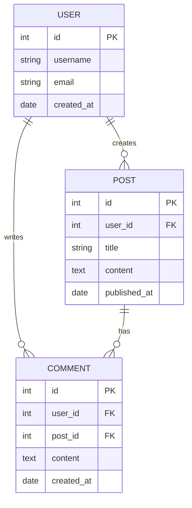
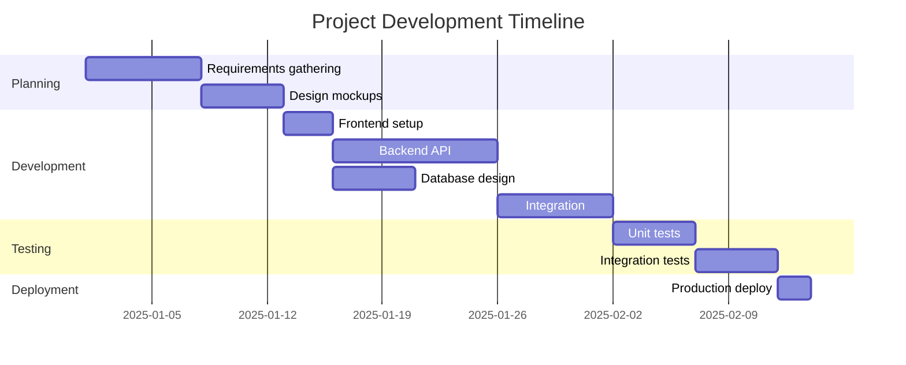
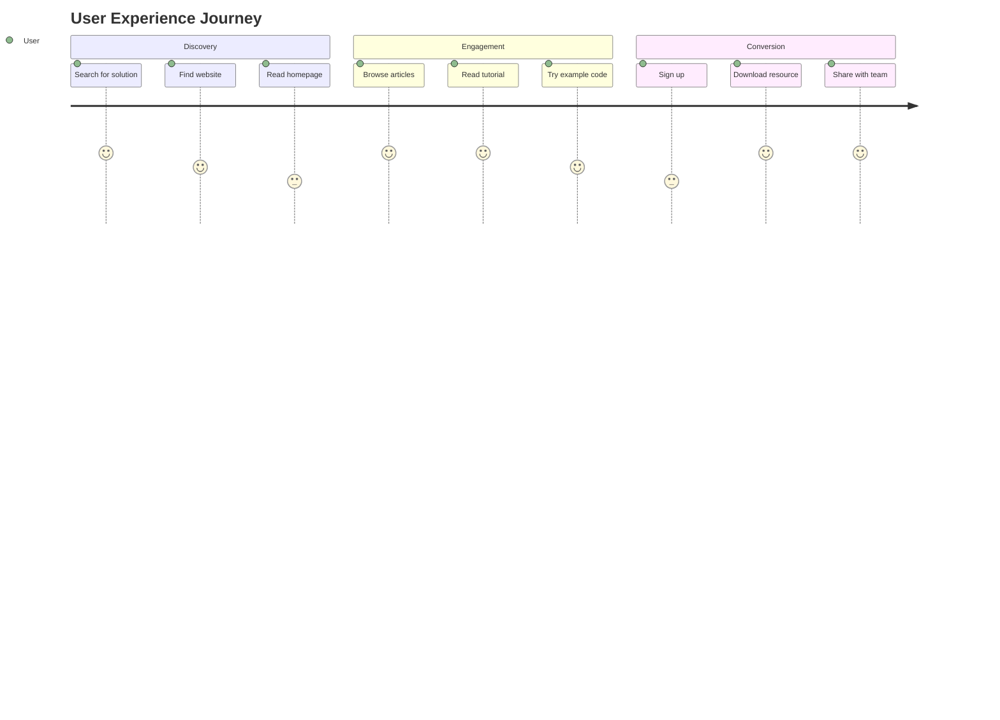
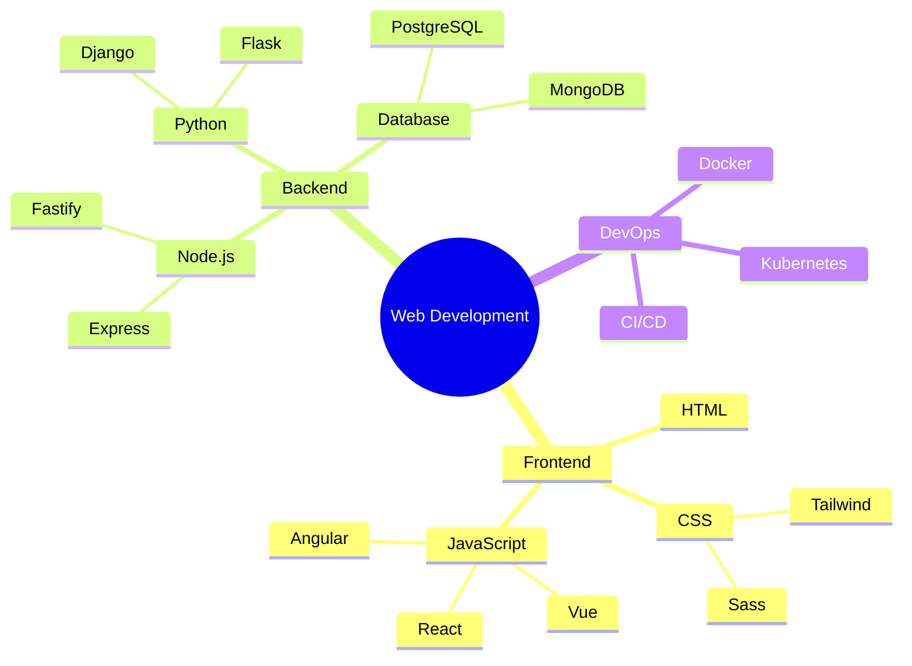

# Complete Markdown Showcase

> This article demonstrates every markdown element and HTML feature styled in our globals.css. Use this as a reference for content creation and to test theme changes.

## Introduction

Welcome to the complete markdown showcase! This living document demonstrates all the supported markdown elements, HTML tags, and styling features available in this Next.js site. Whether you're creating tutorials, guides, or blog posts, you'll find examples of every element here.

---

## Headings Hierarchy

All six heading levels are properly styled with appropriate sizing and spacing:

# Heading 1 - Main Article Title

## Heading 2 - Major Sections

### Heading 3 - Subsections

#### Heading 4 - Minor Sections

##### Heading 5 - Small Headings

###### Heading 6 - Smallest Headings

---

## Text Formatting

### Basic Emphasis

Here are the basic text formatting options:

**Bold text** using double asterisks or double underscores.  
_Italic text_ using single asterisks or single underscores.  
**_Bold and italic_** using triple asterisks.  
~~Strikethrough text~~ using double tildes.

### Advanced Typography

<mark>Highlighted text</mark> using the mark tag.  
<small>Small print text</small> for fine print or side notes.  
Text with <sup>superscript</sup> and <sub>subscript</sub> formatting.

### Special Text Elements

<kbd>Ctrl</kbd> + <kbd>C</kbd> - Keyboard input styling  
<abbr title="HyperText Markup Language">HTML</abbr> - Abbreviations with tooltips  
<cite>The Great Gatsby</cite> by F. Scott Fitzgerald - Citations

---

## Links and References

### Standard Links

[Internal link to homepage](/tutorials)  
[External link to Next.js](https://nextjs.org)  
[Link with title](https://github.com "GitHub Homepage")

### Reference-Style Links

[Reference link][1]  
[Another reference][markdown-guide]

[1]: https://example.com
[markdown-guide]: https://www.markdownguide.org

### Automatic Links

https://www.example.com  
<contact@example.com>

---

## Lists

### Unordered Lists

- First item
- Second item
- Third item with a longer description that wraps to multiple lines to demonstrate how list items handle text flow
  - Nested item level 2
  - Another nested item
    - Nested item level 3
    - Deep nested item

### Ordered Lists

1. First step
2. Second step
3. Third step
   1. Nested numbered item (a)
   2. Nested numbered item (b)
      1. Deep nested item (i)
      2. Deep nested item (ii)

### Mixed Nested Lists

1. Ordered parent
   - Unordered child
   - Another unordered child
     1. Ordered grandchild
     2. Another ordered grandchild
2. Another ordered parent
   - Mixed nesting item

### Task Lists

- [x] Completed task
- [x] Another completed task
- [ ] Pending task
- [ ] Another pending task
  - [x] Nested completed task
  - [ ] Nested pending task

### Definition Lists

<dl>
<dt>First Term</dt>
<dd>Definition of the first term with detailed explanation.</dd>

<dt>Second Term</dt>
<dd>Definition of the second term.</dd>

<dt>Third Term</dt>
<dd>Multiple definitions for this term.</dd>
<dd>Second definition of the same term.</dd>
</dl>

---

## Code Examples

### Inline Code

Use `const` for variables that won't be reassigned, `let` for variables that will change, and avoid `var` in modern JavaScript.

The `useState` hook is fundamental in React, and `useEffect` handles side effects. You can import them like this: `import { useState, useEffect } from 'react'`.

Testing very long inline code: `const veryLongVariableNameThatMightCauseHorizontalScrollingIssuesInInlineCodeElements = "This is a test to see how inline code behaves with extremely long content that might overflow"`.

### Code Blocks with Syntax Highlighting

#### JavaScript/TypeScript

```typescript
// TypeScript example with types
interface User {
  id: number;
  name: string;
  email: string;
  isActive: boolean;
}

const greetUser = (user: User): string => {
  return `Hello, ${user.name}! Your email is ${user.email}`;
};

const users: User[] = [
  { id: 1, name: "Alice", email: "alice@example.com", isActive: true },
  { id: 2, name: "Bob", email: "bob@example.com", isActive: false },
];

users.forEach((user) => {
  if (user.isActive) {
    console.log(greetUser(user));
  }
});
```

#### React/JSX

```jsx
import React, { useState, useEffect } from "react";

const Counter = () => {
  const [count, setCount] = useState(0);
  const [isRunning, setIsRunning] = useState(false);

  useEffect(() => {
    let interval;
    if (isRunning) {
      interval = setInterval(() => {
        setCount((prev) => prev + 1);
      }, 1000);
    }
    return () => clearInterval(interval);
  }, [isRunning]);

  return (
    <div className="counter">
      <h2>Count: {count}</h2>
      <button onClick={() => setIsRunning(!isRunning)}>
        {isRunning ? "Stop" : "Start"}
      </button>
      <button onClick={() => setCount(0)}>Reset</button>
    </div>
  );
};

export default Counter;
```

#### CSS/Tailwind

```css
/* Custom CSS with Tailwind utilities */
@layer components {
  .btn-primary {
    @apply bg-primary text-primary-foreground px-4 py-2 rounded-md;
    @apply hover:bg-primary/90 transition-colors;
    @apply focus:outline-none focus:ring-2 focus:ring-ring;
  }

  .card {
    @apply bg-card border border-border rounded-lg p-6;
    @apply shadow-sm hover:shadow-md transition-shadow;
  }
}
```

#### Long Code Example (Tests Horizontal Scrolling)

```javascript
// This is a very long line of code that should trigger horizontal scrolling when it exceeds the container width
const veryLongFunctionWithManyParametersAndAVeryDescriptiveName = (
  firstParameterWithALongName,
  secondParameterWithAnotherLongName,
  thirdParameterWithYetAnotherLongName,
  fourthParameterWithAnEvenLongerName,
) => {
  const anotherVeryLongVariableNameThatShouldMakeThisLineVeryWideAndTriggerHorizontalScrolling =
    firstParameterWithALongName + secondParameterWithAnotherLongName;

  return {
    veryLongPropertyName:
      anotherVeryLongVariableNameThatShouldMakeThisLineVeryWideAndTriggerHorizontalScrolling,
    anotherVeryLongPropertyNameThatExceedsTheContainerWidth:
      thirdParameterWithYetAnotherLongName,
    yetAnotherPropertyWithAnExtremelLongNameThatDefinitelyExceedsAnyReasonableContainerWidth:
      fourthParameterWithAnEvenLongerName,
  };
};

// Another long line with multiple method calls chained together
const result = veryLongFunctionWithManyParametersAndAVeryDescriptiveName(
  "first",
  "second",
  "third",
  "fourth",
)
  .veryLongPropertyName.toString()
  .toUpperCase()
  .split("")
  .reverse()
  .join("")
  .toLowerCase();
```

#### HTML

```html
<!DOCTYPE html>
<html lang="en">
  <head>
    <meta charset="UTF-8" />
    <meta name="viewport" content="width=device-width, initial-scale=1.0" />
    <title>Example Page</title>
  </head>
  <body>
    <header>
      <nav>
        <ul>
          <li><a href="/">Home</a></li>
          <li><a href="/about">About</a></li>
        </ul>
      </nav>
    </header>
    <main>
      <h1>Welcome</h1>
      <p>This is an example page.</p>
    </main>
  </body>
</html>
```

#### Python

```python
# Python example with classes
class DataProcessor:
    def __init__(self, data):
        self.data = data
        self.processed = False

    def process(self):
        """Process the data and return results"""
        result = [item * 2 for item in self.data if item > 0]
        self.processed = True
        return result

    def __str__(self):
        status = "processed" if self.processed else "unprocessed"
        return f"DataProcessor with {len(self.data)} items ({status})"

# Usage
processor = DataProcessor([1, -2, 3, 4, -5])
print(processor.process())
```

#### Bash/Shell

```bash
#!/bin/bash

# Build and deploy script
echo "Starting build process..."

# Install dependencies
npm install

# Run tests
npm test

# Build for production
npm run build

# Deploy to server
rsync -avz --delete dist/ user@server:/var/www/app/

echo "Deployment complete!"
```

#### JSON

```json
{
  "name": "my-next-app",
  "version": "1.0.0",
  "scripts": {
    "dev": "next dev",
    "build": "next build",
    "start": "next start"
  },
  "dependencies": {
    "next": "^14.0.0",
    "react": "^18.2.0",
    "react-dom": "^18.2.0"
  },
  "devDependencies": {
    "@types/node": "^20.0.0",
    "@types/react": "^18.2.0",
    "typescript": "^5.0.0"
  }
}
```

#### SQL

```sql
-- Create users table
CREATE TABLE users (
  id SERIAL PRIMARY KEY,
  username VARCHAR(50) UNIQUE NOT NULL,
  email VARCHAR(255) UNIQUE NOT NULL,
  created_at TIMESTAMP DEFAULT CURRENT_TIMESTAMP
);

-- Insert sample data
INSERT INTO users (username, email) VALUES
  ('alice', 'alice@example.com'),
  ('bob', 'bob@example.com');

-- Query with join
SELECT u.username, COUNT(p.id) as post_count
FROM users u
LEFT JOIN posts p ON u.id = p.user_id
GROUP BY u.id, u.username
ORDER BY post_count DESC;
```

---

## Blockquotes

### Simple Blockquote

> This is a simple blockquote. It can contain multiple sentences and will be styled with a left border and italic text. Blockquotes are great for highlighting important information or quotes from other sources.

### Blockquote with Attribution

> "The only way to do great work is to love what you do. If you haven't found it yet, keep looking. Don't settle."
>
> — Steve Jobs

### Nested Blockquotes

> This is the first level of quotation.
>
> > This is a nested quote within the first quote.
> >
> > > And this is a third level of nesting.

### Blockquote with Other Elements

> **Note:** This blockquote contains other markdown elements.
>
> - First item in list
> - Second item in list
>
> You can also include `inline code` and **bold text** within blockquotes.

---

## Tables

### Basic Table

| Feature             | Description               | Supported |
| ------------------- | ------------------------- | --------- |
| Markdown            | Write content in markdown | ✅ Yes    |
| Syntax Highlighting | Code blocks with colors   | ✅ Yes    |
| Dark Mode           | Theme switching           | ✅ Yes    |
| Responsive          | Mobile-friendly design    | ✅ Yes    |

### Table with Alignment

| Left Aligned | Center Aligned | Right Aligned |
| :----------- | :------------: | ------------: |
| Left         |     Center     |         Right |
| Text         |      Text      |          Text |
| 1            |       2        |             3 |

### Complex Table

| Language   | Type            | Use Case             | Difficulty | Popular    |
| ---------- | --------------- | -------------------- | ---------- | ---------- |
| JavaScript | Scripting       | Web Development      | Medium     | ⭐⭐⭐⭐⭐ |
| Python     | General Purpose | Data Science         | Easy       | ⭐⭐⭐⭐⭐ |
| Rust       | Systems         | Performance Critical | Hard       | ⭐⭐⭐     |
| Go         | Compiled        | Backend Services     | Medium     | ⭐⭐⭐⭐   |
| TypeScript | Typed Scripting | Large Applications   | Medium     | ⭐⭐⭐⭐⭐ |

### Wide Table (Tests Horizontal Scrolling)

| Column 1                           | Column 2                           | Column 3                           | Column 4                           | Column 5                           | Column 6                           | Column 7                           | Column 8                           | Column 9                           | Column 10                           | Column 11                           | Column 12                           | Column 13                           | Column 14                           | Column 15                           |
| ---------------------------------- | ---------------------------------- | ---------------------------------- | ---------------------------------- | ---------------------------------- | ---------------------------------- | ---------------------------------- | ---------------------------------- | ---------------------------------- | ----------------------------------- | ----------------------------------- | ----------------------------------- | ----------------------------------- | ----------------------------------- | ----------------------------------- |
| This is a very long content item 1 | This is a very long content item 2 | This is a very long content item 3 | This is a very long content item 4 | This is a very long content item 5 | This is a very long content item 6 | This is a very long content item 7 | This is a very long content item 8 | This is a very long content item 9 | This is a very long content item 10 | This is a very long content item 11 | This is a very long content item 12 | This is a very long content item 13 | This is a very long content item 14 | This is a very long content item 15 |
| Data A1                            | Data A2                            | Data A3                            | Data A4                            | Data A5                            | Data A6                            | Data A7                            | Data A8                            | Data A9                            | Data A10                            | Data A11                            | Data A12                            | Data A13                            | Data A14                            | Data A15                            |
| Data B1                            | Data B2                            | Data B3                            | Data B4                            | Data B5                            | Data B6                            | Data B7                            | Data B8                            | Data B9                            | Data B10                            | Data B11                            | Data B12                            | Data B13                            | Data B14                            | Data B15                            |

---

## Images and Media

### Standard Images


### Image with Figure and Caption

<figure>
  
  <figcaption>A developer's workspace showing code on multiple monitors</figcaption>
</figure>

---

## Interactive Elements

### Details and Summary (Accordion)

<details>
<summary>Click to expand: What is Next.js?</summary>

Next.js is a React framework for building full-stack web applications. You use React Components to build user interfaces, and Next.js for additional features and optimizations.

Key features include:

- File-based routing
- Server-side rendering
- Static site generation
- API routes
- Built-in optimization

</details>

<details>
<summary>Click to expand: Code Example</summary>

```typescript
// Next.js page component
export default function Home() {
  return (
    <main>
      <h1>Welcome to Next.js!</h1>
    </main>
  );
}
```

</details>

<details open>
<summary>This accordion is open by default</summary>

Use the `open` attribute on the `<details>` element to make it expanded by default.

</details>

---

## Diagrams with Mermaid

### Flowchart Example



### Sequence Diagram



### Class Diagram



### Git Graph



### Pie Chart



### State Diagram



### Entity Relationship Diagram



### Gantt Chart



### Journey Diagram



### Mindmap



---

## Horizontal Rules

Use three or more hyphens, asterisks, or underscores:

---

---

---

---

## Special HTML Elements

### Address Element

<address>
  Written by <a href="mailto:author@example.com">John Doe</a><br>
  Visit us at: example.com<br>
  Box 123, Some Street<br>
  Some City, SC 12345<br>
  USA
</address>

### Preformatted Text (Without Code)

<pre>
  ┌─────────────────────────────┐
  │  ASCII Art Box              │
  │  Preformatted text          │
  │  preserves    spacing       │
  └─────────────────────────────┘
</pre>

---

## Real-World Examples

### Tutorial Example: React Hook

Here's a practical example combining multiple elements:

#### Creating a Custom useLocalStorage Hook

**Problem:** We need to sync state with localStorage in React.

**Solution:** Create a custom hook that handles this automatically.

```typescript
import { useState, useEffect } from "react";

function useLocalStorage<T>(key: string, initialValue: T) {
  // Get stored value or use initial value
  const [storedValue, setStoredValue] = useState<T>(() => {
    try {
      const item = window.localStorage.getItem(key);
      return item ? JSON.parse(item) : initialValue;
    } catch (error) {
      console.error(error);
      return initialValue;
    }
  });

  // Update localStorage when value changes
  useEffect(() => {
    try {
      window.localStorage.setItem(key, JSON.stringify(storedValue));
    } catch (error) {
      console.error(error);
    }
  }, [key, storedValue]);

  return [storedValue, setStoredValue] as const;
}

// Usage
function App() {
  const [name, setName] = useLocalStorage("name", "Guest");

  return <input value={name} onChange={(e) => setName(e.target.value)} />;
}
```

> 💡 **Pro Tip:** This hook automatically syncs with localStorage, so your state persists across page refreshes!

**Features:**

- [x] TypeScript support
- [x] Error handling
- [x] Automatic serialization
- [x] Simple API

---

## Comparison Table: Good vs Bad Practices

| ❌ Bad Practice          | ✅ Good Practice                      |
| ------------------------ | ------------------------------------- |
| `var x = 1`              | `const x = 1` or `let x = 1`          |
| Inline styles everywhere | CSS classes or Tailwind utilities     |
| No error handling        | Try-catch blocks and error boundaries |
| Prop drilling 5+ levels  | Context or state management library   |
| No TypeScript types      | Proper type definitions               |

---

## Nested Content Example

### Complex List with Multiple Elements

1. **First Major Step: Setup**

   Install the required dependencies:

   ```bash
   npm install react react-dom next
   ```

   > **Note:** Make sure you have Node.js 18+ installed
   - Verify installation with: `node --version`
   - Check npm version: `npm --version`

2. **Second Major Step: Configuration**

   Create your configuration file:

   ```json
   {
     "compilerOptions": {
       "target": "ES2020",
       "module": "ESNext"
     }
   }
   ```

   Key settings to remember:
   - Target ES2020 for modern features
   - Use ESNext for latest module syntax
   - Enable `strict` mode for type safety

3. **Third Major Step: Implementation**

   <details>
   <summary>View implementation code</summary>

   ```typescript
   export default function Component() {
     return <div>Hello World</div>;
   }
   ```

   </details>

---

## Mathematical and Scientific Notation

### Inline Equations

The formula for the area of a circle is $A = \pi r^2$, where $r$ is the radius.

Einstein's famous equation: $E = mc^2$

### Block Equations

$$
\frac{-b \pm \sqrt{b^2 - 4ac}}{2a}
$$

$$
\sum_{i=1}^{n} i = \frac{n(n+1)}{2}
$$

---

## Color Reference for Code

Our syntax highlighting uses semantic colors:

| Element Type | Color Variable     | Usage                         |
| ------------ | ------------------ | ----------------------------- |
| Keywords     | `destructive`      | `const`, `function`, `return` |
| Strings      | `chart-2`          | `"text"`, `'text'`            |
| Numbers      | `chart-1`          | `123`, `4.56`                 |
| Comments     | `muted-foreground` | `// comment`                  |
| Functions    | `chart-4`          | Function names                |

---

## Accessibility Features

### Skip Link

The site includes a skip-to-content link for keyboard navigation (press <kbd>Tab</kbd> at page load).

### Semantic HTML

All elements use proper semantic HTML:

- `<article>` for main content
- `<nav>` for navigation
- `<main>` for primary content
- `<aside>` for sidebars

---

## Conclusion

This showcase demonstrates all the markdown and HTML elements styled in our globals.css. Key takeaways:

1. **Rich Typography** - Six heading levels, emphasis, and special text elements
2. **Code Support** - Syntax highlighting for 10+ languages
3. **Interactive Elements** - Details/summary accordions, task lists
4. **Tables** - Full support with alignment options
5. **Media** - Images, figures, and embeds
6. **Accessibility** - Semantic HTML and keyboard navigation

### Next Steps

- Use this as a reference when creating content
- Test new theme customizations against this page
- Ensure all elements look good in both light and dark modes
- Check responsive behavior on mobile devices

### Related Resources

- [Markdown Guide](https://www.markdownguide.org)
- [Next.js Documentation](https://nextjs.org/docs)
- [Tailwind CSS](https://tailwindcss.com)

---

**Last Updated:** November 7, 2025  
**Status:** Complete  
**Version:** 1.0.0
