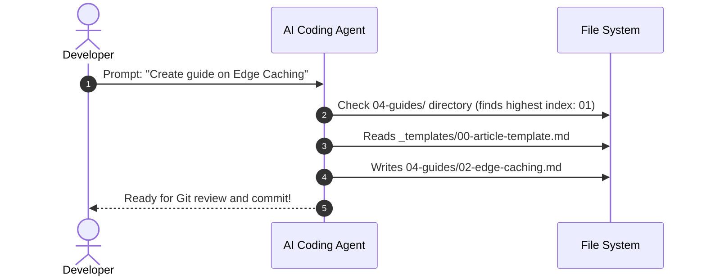

The biggest superpower of The Static Web is enabling AI coding agents to author, organize, and validate articles autonomously. Because content lives in plain Markdown files on your local drive, agents can inspect existing categories, adhere to strict formatting standards, and generate production-ready documentation.

### The Agent Prompt Blueprint
When instructing your AI assistant, use this structured prompt pattern:

```text
Please create a new article in the '04-guides' category about 'Edge Caching Strategies'.
1. Inspect content/04-guides/ to determine the next sequential file prefix.
2. Follow content/_templates/00-article-template.md for YAML front matter.
3. Include a relevant mermaid sequence diagram explaining edge cache invalidation.
4. Use DD-MM-YYYY format for the date.
5. Provide a crisp 120-160 character description and 3 tags.
```



### Automated Multi-Card Swiper Generation
To generate an interactive Swiper section, instruct your AI:

```text
Create a multi-step tutorial inside a folder named 04-guides/03-database-migration/
with numbered cards:
- 01-intro.md
- 02-schema.md
- 0.3.1-step-one.md
- 0.3.2-step-two.md
- 04-summary.md
```

The Static Web compiler automatically groups these cards into an interactive carousel with zero configuration!

