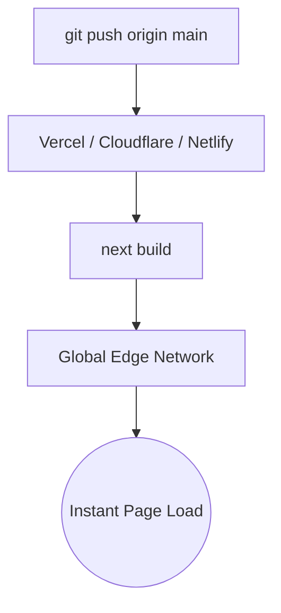

Deploying The Static Web is effortless because there are no databases to provision, no VPC peering connections to establish, and no connection pooling issues.



### Deploying to Vercel (Recommended)
1. Push your repository to GitHub.
2. Visit [Vercel Dashboard](https://vercel.com/new) and click **Add New Project**.
3. Import your GitHub repository. Vercel automatically detects Next.js framework settings.
4. Click **Deploy**. Your site will be live on a global CDN in under 60 seconds with automatic preview deployments for every Pull Request.

### Generating Static HTML/CSS Export
If you want to host on static web servers (Apache, Nginx, AWS S3, or GitHub Pages), generate a pre-built static export:

```bash
npm run build
```

Your optimized, production-ready static assets are compiled to the `out/` or `.next/` directory ready for any web server.

